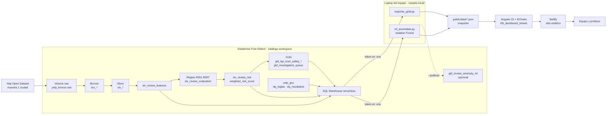
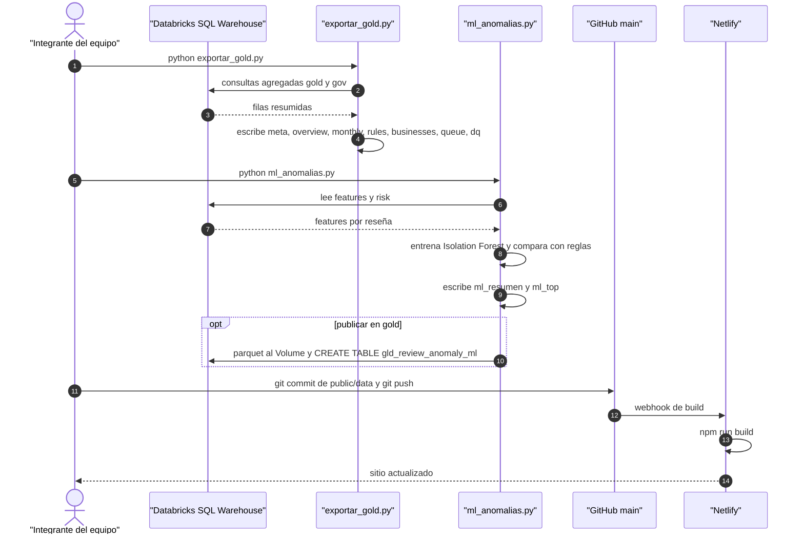

# Arquitectura — Dashboard Trust & Safety + ML de anomalías
### Capstone YelpConnect · Grupo 05 · Diplomado de Arquitectura de Datos UTEC

## 1. Propósito y alcance

Cerrar el Capstone con dos piezas pequeñas que **consumen** lo que ya construyó el pipeline (E7), sin rehacerlo:

- **E8 · Dashboard BI**: sitio web público (Angular + ECharts en Netlify) con los KPIs de Trust & Safety y la salud de calidad de datos.
- **EX · Bonus ML**: detección de anomalías no supervisada (Isolation Forest) que **complementa** las reglas heurísticas R001–R007.

Fuera de alcance: reentrenar o cambiar el pipeline, conexión en vivo del navegador a Databricks, etiquetar fraude real.

## 2. Vista general



## 3. Componentes

| Componente | Tecnología | Ubicación | Responsabilidad |
|---|---|---|---|
| Pipeline medallón + T&S | PySpark, Delta, Unity Catalog | `E7_pipeline_lakehouse/` | Bronze → Silver → features → reglas → riesgo → Gold (ya existe) |
| Motor de calidad | PySpark | `E5_calidad_datos/` | Reglas `DQ-nnn` y resultados en `yelp_gov` (ya existe) |
| Conexión común | `databricks-sql-connector`, `python-dotenv` | `local/yelp_local/db.py` | Abre la conexión al SQL Warehouse leyendo `.env` |
| Escritor de salida | Python, JSON | `local/yelp_local/salida.py` | Escribe los JSON en `E8_dashboard_bi/web/public/data/` |
| Exportador gold | Python, pandas | `local/exportar_gold.py` | Lee `yelp_gold` + `yelp_gov` y genera JSON agregados. `--demo`: datos sintéticos; `--verificar`: describe las tablas |
| ML de anomalías | scikit-learn, pandas, pyarrow | `local/ml_anomalias.py` | Isolation Forest + comparación con reglas → JSON. `--publicar`: sube parquet al Volume y crea `gld_review_anomaly_ml` |
| Dashboard web | Angular 22 standalone, ECharts | `E8_dashboard_bi/web/` | 6 páginas que leen solo los JSON |
| Hosting | Netlify (plan gratuito) | `netlify.toml` | Build y publicación del sitio estático |

**Páginas del dashboard:** Resumen T&S · Reglas · Negocios · Cola de investigación · ML (Reglas vs Modelo) · Gobierno de datos (DQ).

## 4. Fuentes de datos por pieza

| Tabla | Capa | Consumida por | JSON resultante |
|---|---|---|---|
| `yelp_gold.gld_kpi_trust_safety_overview` | Gold | `exportar_gold.py` | `overview.json` |
| `yelp_gold.gld_kpi_trust_safety_daily` | Gold | `exportar_gold.py` | `monthly.json` (agregado por mes) |
| `yelp_gold.gld_kpi_trust_safety_rule` | Gold | `exportar_gold.py` | `rules.json` |
| `yelp_gold.gld_kpi_trust_safety_business` | Gold | `exportar_gold.py` | `businesses.json` (top N) |
| `yelp_gold.gld_investigation_queue` | Gold | `exportar_gold.py` | `queue.json` (top N, enmascarado) |
| `yelp_gov.dq_resultados` | Gov | `exportar_gold.py` | `dq.json` (última ejecución) |
| `yelp_silver.slv_review_features` | Silver | `ml_anomalias.py` | entrada del modelo |
| `yelp_silver.slv_review_risk` | Silver | `ml_anomalias.py` | `ml_resumen.json`, `ml_top.json` |
| — | — | ambos scripts | `meta.json` (fecha de corte, run, modo demo/real) |

> El **dashboard** solo ve datos derivados de gold/gov. El script de ML lee silver porque es una **etapa de producción de datos** (como E7), no un consumidor BI; su resultado se publica en gold.

## 5. Flujo de actualización



## 6. Componente ML

**¿Por qué no supervisado?** No existen etiquetas de fraude confirmado. Entrenar un clasificador con las salidas de las reglas sería circular (el modelo solo aprendería a imitarlas). Isolation Forest detecta reseñas **raras respecto al resto**, sin necesitar etiquetas.

**Features** (de `slv_review_features`; conteos con `log1p`, `rating_deviation` en valor absoluto, nulos imputados con la mediana):
`user_reviews_30m`, `user_reviews_1h`, `user_reviews_24h`, `user_review_count`, `rating_deviation`, `text_length`, `text_repeat_count`, `account_age_days`, `user_business_review_count`, `user_business_concentration`, `business_spike_ratio`, `business_day_zscore`, `review_hour`.

**Salida por reseña**

| Columna | Significado |
|---|---|
| `anomaly_score` | `-score_samples` del modelo: mayor = más atípica |
| `anomaly_percentile` | percentil 0–100 del score |
| `is_anomaly_ml` | `true` para el 1 % más atípico (`contamination = 0.01`) |
| `top_features` | las 3 features más alejadas de la mediana (z robusto con IQR) |
| `coincidencia` | `ambos` / `solo_reglas` / `solo_ml` / `ninguno` |

**Comparación con las reglas** (`requires_investigation` en `slv_review_risk`, misma corrida publicada en gold). Además se reporta qué % de anomalías tiene al menos una señal (`signal_count > 0`), el índice de Jaccard y la correlación de Spearman entre `anomaly_score` y `weighted_risk_score`:

| | ML: anómala | ML: normal |
|---|---|---|
| **Reglas: investigar** | Ambos → máxima prioridad | Solo reglas |
| **Reglas: sin alerta** | Solo ML → **casos nuevos** a revisar | Ninguno |

El cuadrante **"Solo ML"** es el aporte: patrones que ninguna regla captura y que pueden inspirar nuevas reglas (ciclo con E6 / catálogo de reglas).

> ⚠️ Igual que el `weighted_risk_score`, el resultado del modelo es una **señal para investigación, NO fraude confirmado**.

## 7. Decisiones de arquitectura y gobierno

| Decisión | Motivo |
|---|---|
| El dashboard consume solo gold/gov | Regla de E8: valida la arquitectura de capas |
| Snapshot estático en JSON, sin conexión en vivo | El token **nunca** llega al navegador; vive solo en `local/.env`, ignorado por git |
| Enmascaramiento: `user_id` hasheado, texto truncado a 200 caracteres | El sitio es público; principio de minimización |
| Modo demo visible en la UI (banner) | `--demo` permite desarrollar sin Databricks, pero no debe confundirse con datos reales |
| FinOps: consultas agregadas y top N | Cuota serverless diaria de Free Edition; solo el ML trae features por reseña |
| `meta.json` con fecha de corte y run | Trazabilidad: qué ejecución del pipeline muestra el dashboard |
| Contrato de datos fijo (`public/data/*.json`) | Desacopla Angular del pipeline: si cambia una tabla, solo cambia el exportador |

## 8. Cómo ejecutar

```bash
# 1. Entorno Python (desde la raíz del repo)
cd local
python -m venv .venv && .venv\Scripts\activate      # Windows
pip install -r requirements.txt
copy .env.example .env                                # completar hostname, http path y token

# 2. Generar datos del dashboard
python exportar_gold.py              # o: --demo (sin Databricks) / --verificar
python ml_anomalias.py               # opcional: --publicar

# 3. Dashboard local
cd ../E8_dashboard_bi/web
npm install
npm start                            # http://localhost:4200
```

**Netlify:** conectar el repo · Base directory `E8_dashboard_bi/web` · Build command `npm run build` · Publish directory `dist/web/browser`.

## 9. Trazabilidad con entregables

| Entregable / Módulo | Qué aporta esta arquitectura |
|---|---|
| E7 · Pipeline lakehouse | Fuente: gold T&S y features; no se modifica |
| E8 · Dashboard BI | Sitio Angular con 6 páginas, incluida la de Gobierno (DQ) |
| EX · Bonus IA | Modelo de anomalías y tabla `gld_review_anomaly_ml` |
| M9 · BI y Visualización | KPIs por stakeholder, storytelling por página |
| M8 · IA y No Estructurados | ML aplicado a señales de reseñas, con gobierno del resultado |
| M10 · DataOps / MLOps / FinOps | Flujo reproducible por scripts, despliegue continuo en Netlify, control de cuota |

## 10. Riesgos y próximos pasos

**Riesgos / limitaciones**
- El snapshot puede quedar desactualizado si nadie vuelve a correr los scripts.
- El token personal es por usuario: rotarlo y no commitearlo nunca.
- Isolation Forest es sensible al parámetro de contaminación; sin etiquetas no hay métricas de precisión, solo análisis cualitativo de casos.
- Aunque el Yelp Open Dataset es público, se publica con enmascaramiento por buena práctica.

**Próximos pasos**
- Revisar con el equipo 10–20 casos "Solo ML" y documentar hallazgos.
- Registrar el modelo con MLflow en Databricks si sobra cuota.
- Programar el refresco junto al job de E7 (`04_job_orquestacion`).
