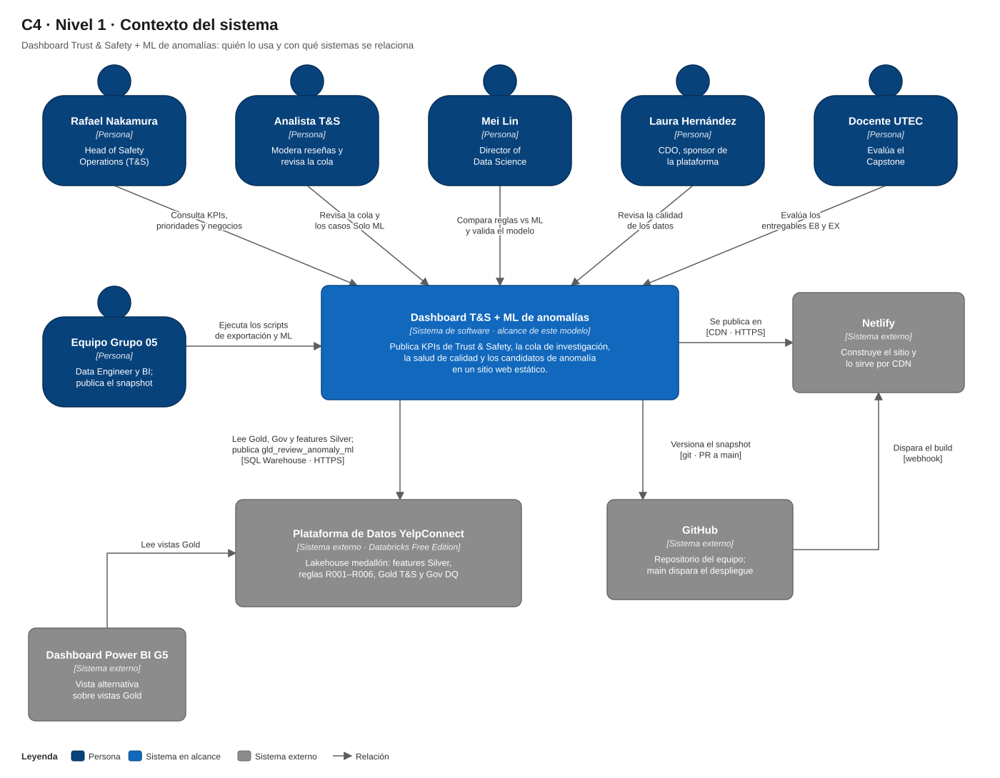
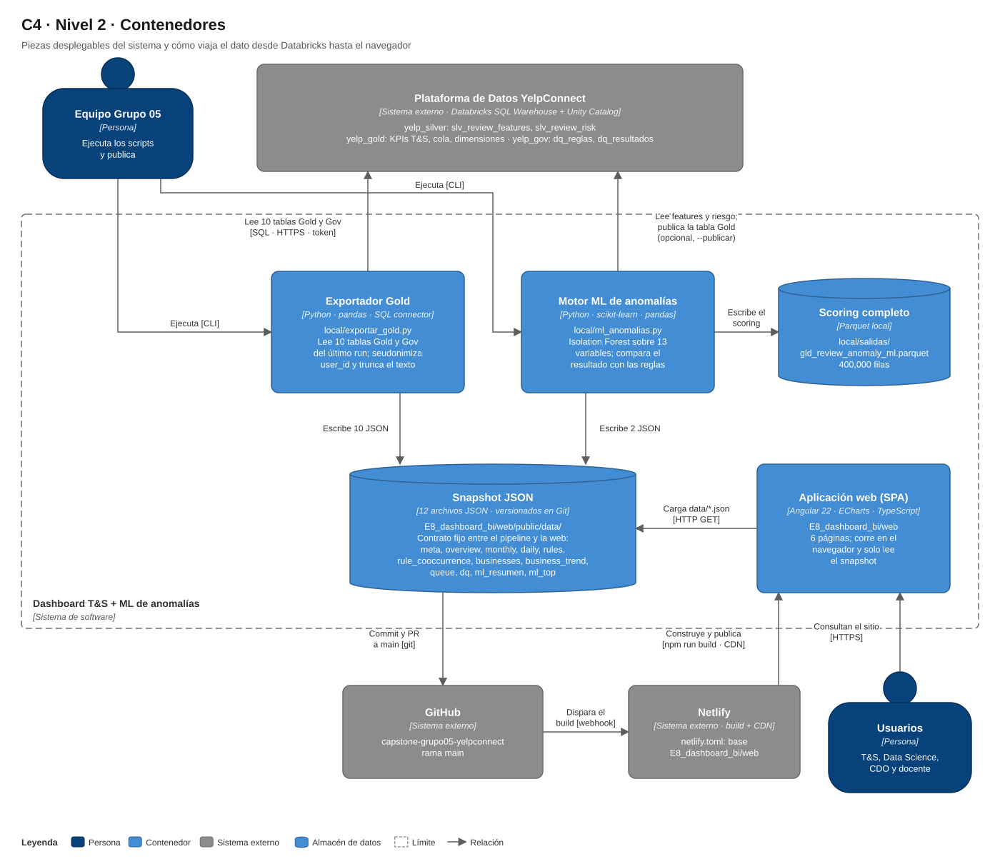
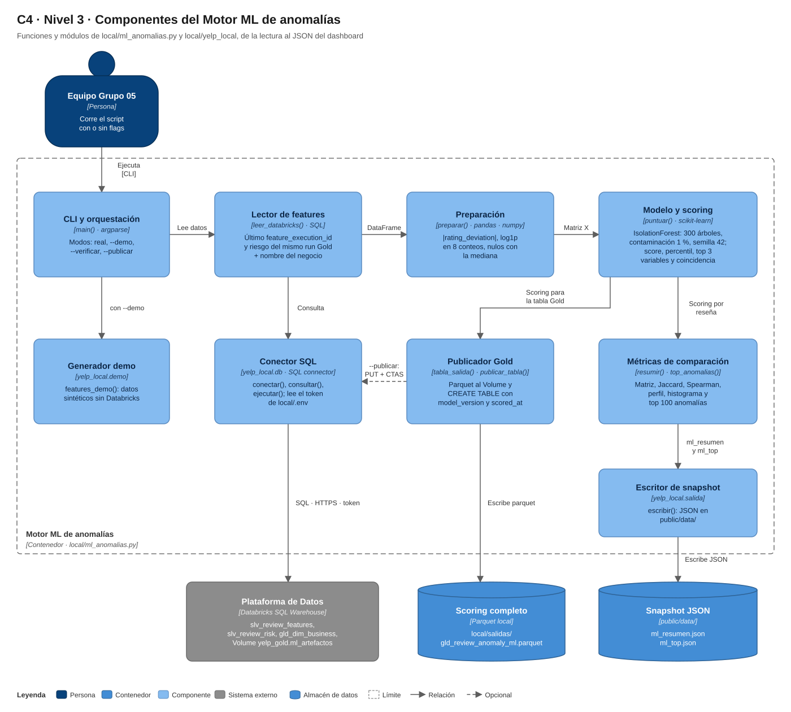
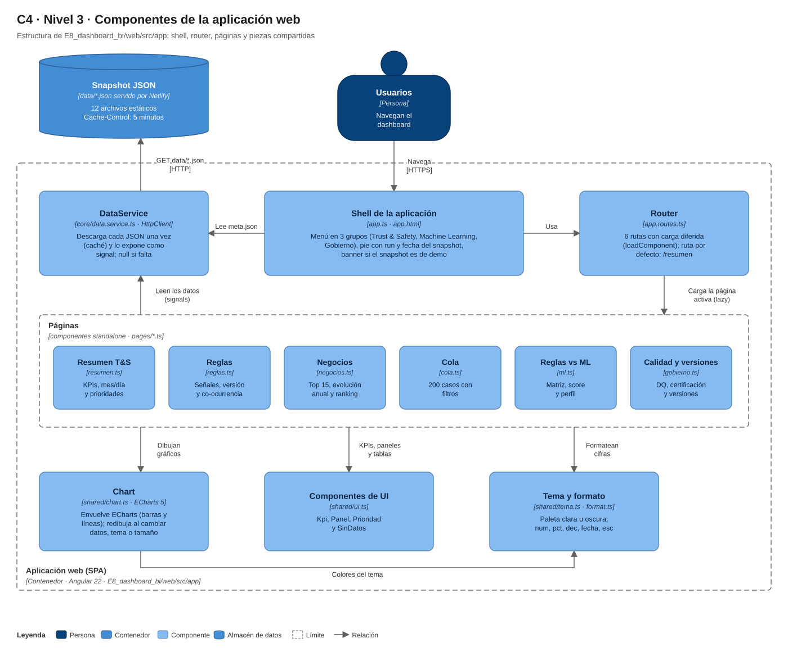
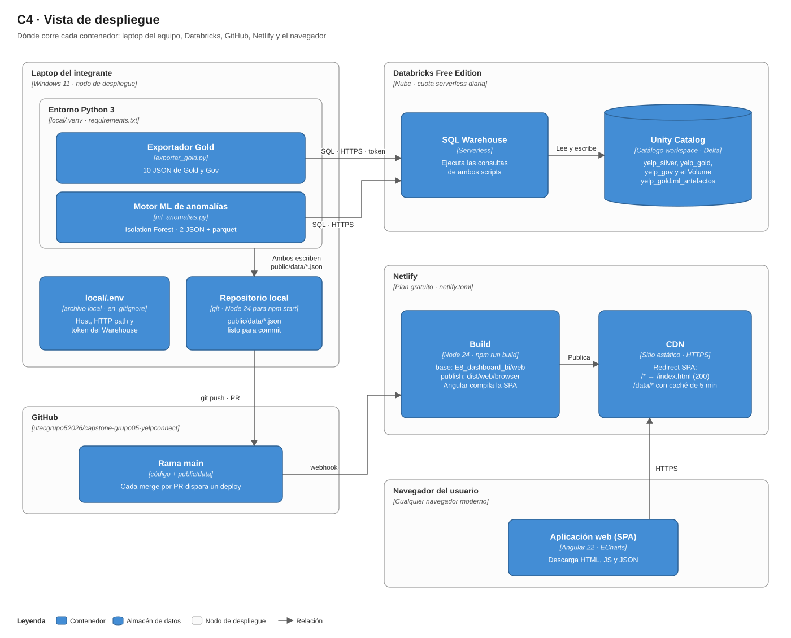
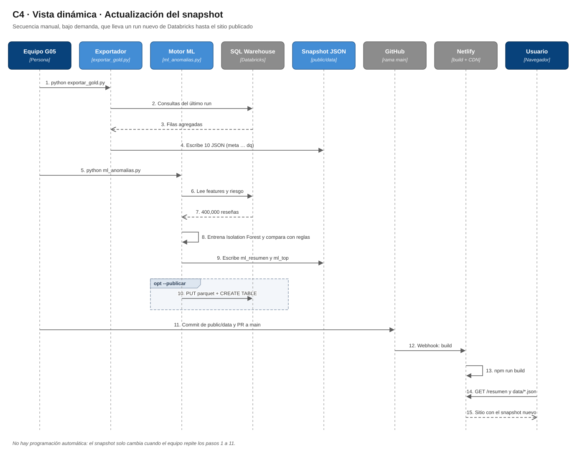

# Modelo C4 — Dashboard T&S + ML de anomalías

### Capstone YelpConnect · Grupo 05 · Arquitectura de Datos UTEC

Este modelo C4 cubre lo que el equipo construyó **encima** de la plataforma de datos: el
exportador de Gold, el motor ML de anomalías (Isolation Forest), el snapshot JSON y el
sitio Angular publicado en Netlify. Amplía las figuras 3-2 (`03_02_c4_context.drawio`) y
3-3 (`03_03_c4_container.drawio`) del Documento Formal. Esas figuras describen la plataforma
completa; este modelo hace zoom en el sistema que la consume.

| Archivo | Contenido |
|---|---|
| `03_07_c4_ml_dashboard.drawio` | Fuente editable con 6 páginas, una por vista |
| `svg/*.svg` | Las mismas vistas en vectorial, para el README, el documento o una presentación |
| `png/*.png` | Copia en imagen de cada vista, para Word o diapositivas |

Las cifras de las vistas salen del snapshot del run `6c95bbfe-aa13-4a07-bc28-9f50aad51fdb`
(`meta.json`, exportado el 2026-11-03). Son señales heurísticas y candidatos a revisión,
**no fraude confirmado**.

---

## Vista 1 · Contexto del sistema (C4 nivel 1)

**Qué responde:** quién usa el sistema y de qué otros sistemas depende.

| Elemento | Tipo | Papel |
|---|---|---|
| Rafael Nakamura (Head of Safety Operations) | Persona | Consulta KPIs, prioridades P1/P2/P3 y negocios con más señal |
| Analista T&S | Persona | Revisa la cola de investigación y los casos que solo marca el ML |
| Mei Lin (Director of Data Science) | Persona | Compara reglas contra ML y valida el modelo |
| Laura Hernández (CDO, sponsor) | Persona | Revisa la calidad de datos de la corrida |
| Docente UTEC | Persona | Evalúa los entregables E8 y EX |
| Equipo Grupo 05 | Persona | Ejecuta los scripts y publica el snapshot |
| **Dashboard T&S + ML de anomalías** | Sistema (alcance) | Publica KPIs, cola, calidad y candidatos de anomalía en un sitio estático |
| Plataforma de Datos YelpConnect | Externo | Lakehouse en Databricks: features Silver, reglas R001–R006, Gold T&S, Gov DQ |
| GitHub | Externo | Versiona código y snapshot; `main` dispara el despliegue |
| Netlify | Externo | Construye el sitio y lo sirve por CDN |
| Dashboard Power BI G5 | Externo | Vista alternativa que el equipo arma directamente sobre vistas Gold |

## Vista 2 · Contenedores (C4 nivel 2)

**Qué responde:** qué piezas se despliegan por separado y cómo viaja el dato desde
Databricks hasta el navegador.

| Contenedor | Tecnología | Responsabilidad |
|---|---|---|
| Exportador Gold | Python · pandas · SQL connector (`local/exportar_gold.py`) | Lee 10 tablas Gold y Gov del último run (KPI, riesgo por reseña, cola, dimensiones de regla y run, resultados DQ), seudonimiza `user_id` y trunca el texto a 200 caracteres. Escribe 10 JSON |
| Motor ML de anomalías | Python · scikit-learn (`local/ml_anomalias.py`) | Puntúa 400,000 reseñas con Isolation Forest sobre 13 variables y compara el resultado con las reglas. Escribe 2 JSON y un parquet; con `--publicar` crea `yelp_gold.gld_review_anomaly_ml` |
| Scoring completo | Parquet local (`local/salidas/`) | Score de todas las reseñas. No va al sitio |
| Snapshot JSON | 12 archivos en `E8_dashboard_bi/web/public/data/` | Contrato fijo entre pipeline y web: `meta`, `overview`, `monthly`, `daily`, `rules`, `rule_cooccurrence`, `businesses`, `business_trend`, `queue`, `dq` (exportador) y `ml_resumen`, `ml_top` (ML) |
| Aplicación web (SPA) | Angular 22 · ECharts 5 (`E8_dashboard_bi/web`) | 6 páginas que corren en el navegador y solo leen el snapshot |

## Vista 3 · Componentes del Motor ML (C4 nivel 3)

| Componente | Dónde vive | Qué hace |
|---|---|---|
| CLI y orquestación | `main()` · argparse | Modos: real, `--demo`, `--verificar`, `--publicar` |
| Lector de features | `leer_databricks()` | Último `feature_execution_id`, el riesgo del mismo run Gold y el nombre del negocio |
| Preparación | `preparar()` | Valor absoluto de `rating_deviation`, `log1p` en 8 conteos, nulos imputados con la mediana |
| Modelo y scoring | `puntuar()` | `IsolationForest(n_estimators=300, contamination=0.01, random_state=42)`; score, percentil, top 3 variables (z robusto con IQR) y coincidencia con reglas |
| Métricas de comparación | `resumir()` · `top_anomalias()` | Matriz reglas vs ML, Jaccard, Spearman, perfil de variables, histograma y top 100 |
| Escritor de snapshot | `yelp_local.salida` | Escribe `ml_resumen.json` y `ml_top.json` |
| Publicador Gold | `tabla_salida()` · `publicar_tabla()` | Escribe el parquet; con `--publicar` lo sube al Volume `yelp_gold.ml_artefactos` y crea la tabla con `model_version` y `scored_at` |
| Conector SQL | `yelp_local.db` | `conectar()`, `consultar()`, `ejecutar()`; lee el token de `local/.env` |
| Generador demo | `yelp_local.demo` | Datos sintéticos para desarrollar sin Databricks |

## Vista 4 · Componentes de la aplicación web (C4 nivel 3)

| Componente | Archivo | Qué hace |
|---|---|---|
| Shell | `app.ts` · `app.html` | Menú en 3 grupos (Trust & Safety, Machine Learning, Gobierno), pie con run y fecha, banner si el snapshot es demo |
| Router | `app.routes.ts` | 6 rutas con `loadComponent` (carga diferida); por defecto `/resumen` |
| DataService | `core/data.service.ts` | Descarga cada JSON una vez (`shareReplay`) y lo expone como signal; devuelve `null` si falta el archivo |
| Páginas | `pages/*.ts` | Resumen T&S, Reglas, Negocios, Cola, Reglas vs ML, Calidad y versiones. Cada panel lleva la etiqueta del REQ de la sección 7.1 que responde |
| Chart | `shared/chart.ts` | Envuelve ECharts y redibuja al cambiar datos, tema o tamaño |
| Componentes de UI | `shared/ui.ts` | `Kpi`, `Panel`, `Prioridad`, `SinDatos` |
| Tema y formato | `shared/tema.ts` · `format.ts` | Paleta clara u oscura; formateo de números, porcentajes y fechas |

## Vista 5 · Despliegue

| Nodo | Qué corre |
|---|---|
| Laptop del integrante | Entorno Python 3 con ambos scripts, `local/.env` (en `.gitignore`) y el repo local |
| Databricks Free Edition | SQL Warehouse serverless y Unity Catalog (`yelp_silver`, `yelp_gold`, `yelp_gov`, Volume `ml_artefactos`) |
| GitHub | Rama `main`; cada merge por PR dispara un deploy |
| Netlify | Build (Node 24, `npm run build`, base `E8_dashboard_bi/web`, publish `dist/web/browser`) y CDN (redirect SPA `/* → /index.html`, `/data/*` con caché de 5 minutos) |
| Navegador del usuario | La SPA, que descarga HTML, JS y JSON |

## Vista 6 · Dinámica de actualización del snapshot

Secuencia de 15 pasos, **manual y bajo demanda**. El paso 10 solo ocurre con `--publicar`.
No hay programación automática: el sitio cambia solo cuando el equipo repite los pasos 1 a 11.

---

## Decisiones que el modelo hace visibles

| Decisión | Dónde se ve | Respaldo |
|---|---|---|
| El dashboard consume solo Gold y Gov (y features Silver para el ML) | Vistas 1 y 2 | ADR-10 (mínimo privilegio y consumo desde Gold) |
| El ML queda fuera del `risk_score` base; es una señal paralela que se compara, no se suma | Vista 3 (Métricas de comparación) | ADR-12 (IA/ML experimental fuera del score base) |
| Snapshot estático sin conexión en vivo: el token nunca llega al navegador | Vistas 2 y 5 (`local/.env`) | `ARQUITECTURA_DASHBOARD_ML.md` §7 |
| Enmascaramiento: `user_id` seudonimizado y texto truncado a 200 caracteres | Vista 2 (Exportador) | ADR-10, minimización |
| FinOps: consultas agregadas y top N; solo el ML baja features por reseña | Vistas 2 y 5 | Cuota serverless diaria de Free Edition |
| Contrato fijo de 12 JSON entre pipeline y web | Vista 2 (Snapshot JSON) | Desacopla Angular del modelo físico |

## Atributos de calidad y riesgos

| Tema | Estado | Acción sugerida |
|---|---|---|
| Frescura | El snapshot envejece si nadie repite la secuencia de la vista 6 | Programarlo junto al job de E7 (`04_job_orquestacion`) |
| Privacidad | `hash_corto` es SHA-256 sin sal, truncado a 10 caracteres: alguien que conozca un `user_id` puede recalcular el hash | Agregar una sal secreta en `local/.env` |
| Secretos | El token del Warehouse es personal | Rotarlo y no commitearlo nunca |
| Validez del modelo | Sin ground truth: no hay precisión ni recall, solo revisión cualitativa | Revisar casos "Solo ML" con T&S antes de promover |
| Explicabilidad | El z robusto usa el IQR; una variable con IQR 0 nunca aparece entre las top 3 | Usar desviación absoluta a la mediana como respaldo |
| Disponibilidad | Si falta un JSON, la página muestra un aviso ("Sin queue.json", "Sin dq.json"…) en lugar de romperse | Ya cubierto por `DataService` |

## Trazabilidad

| Entregable / módulo | Vistas | Qué aporta |
|---|---|---|
| E7 · Pipeline lakehouse | 1, 2, 5 | Fuente: Gold T&S, Gov DQ y features Silver; no se modifica |
| E8 · Dashboard BI | 2, 4, 5, 6 | Sitio Angular con 6 páginas |
| EX · Bonus IA | 3 | Modelo de anomalías y tabla `gld_review_anomaly_ml` |
| M8 · IA y No Estructurados | 3 | ML aplicado a señales de reseñas, gobernado por ADR-12 |
| M9 · BI y Visualización | 1, 4 | KPIs por stakeholder (REQ-01 a REQ-07; mapa REQ → página → JSON en `ARQUITECTURA_DASHBOARD_ML.md`) |
| M10 · DataOps / MLOps / FinOps | 5, 6 | Flujo reproducible por scripts, despliegue continuo, control de cuota |

La página **Reglas vs ML** no tiene un REQ propio en el Documento Formal. La guía de
lectura del dashboard propone agregar un REQ-08 y un ADR-13 para cubrirla.

## Cómo editar

1. Abrir `03_07_c4_ml_dashboard.drawio` en [app.diagrams.net](https://app.diagrams.net) o
   en la extensión Draw.io de VS Code. Cada vista es una página (pestañas abajo).
2. Mantener la paleta C4: persona `#08427B`, sistema `#1168BD`, contenedor `#438DD5`,
   componente `#85BBF0`, externo `#8C8C8C`. Límites con línea discontinua; nodos de despliegue con borde gris continuo.
3. Exportar la página editada como SVG (`Archivo → Exportar como → SVG`) sobre
   `svg/<vista>.svg`, y como PNG sobre `png/<vista>.png`.
4. Si cambia un nombre de archivo, tabla o JSON en el código, actualizar la vista y la tabla
   correspondiente de este README en el mismo PR.
